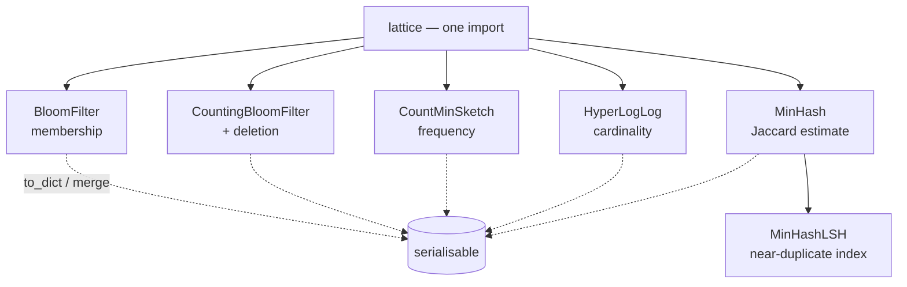

<p align="center">
  <em>Trade a small, bounded error for orders of magnitude less memory.</em>
</p>

<p align="center">
  
  
  
</p>

---

Four probabilistic data structures in pure Python: Bloom filter, count-min sketch,
hyperloglog and minhash. Each answers one question approximately, in space that
does not grow with the number of items.

## Quick start

```python
from lattice import BloomFilter, CountMinSketch, HyperLogLog, MinHash

# 1. Membership — "have I seen this user?"
bf = BloomFilter(capacity=100_000, false_positive_rate=0.01)
bf.add("user:42")
bf.contains("user:42")          # True
bf.contains("user:9999")        # False, with a 1% chance of a false positive

# 2. Frequency — "how often did this key appear?"
cms = CountMinSketch(width=1000, depth=5)
for _ in range(37):
    cms.add("GET /api/orders")
cms.estimate("GET /api/orders")  # 37 or slightly more — never less

# 3. Cardinality — "how many unique items in this stream?"
hll = HyperLogLog(p=14)
hll.add_many(f"id-{i}" for i in range(100_000))
hll.count()                      # ~100_000, within ~0.81% at p=14

# 4. Similarity — "are these two sets near-duplicates?"
a = MinHash(num_perm=128); a.update_batch(["the", "quick", "brown", "fox"])
b = MinHash(num_perm=128); b.update_batch(["the", "quick", "brown", "dog"])
a.jaccard(b)                     # estimate of |A∩B| / |A∪B|
# update() = one element; update_batch() = iterable
```

Near-duplicate indexing:

```python
from lattice import MinHashLSH
lsh = MinHashLSH(threshold=0.8, num_perm=128)
lsh.insert("doc-1", a)
lsh.query(a)                     # candidates above the threshold
```

## What each structure is for

| Structure | Question | Error | Why not a `set` |
|---|---|---|---|
| `BloomFilter` | Have I seen this? | false positives only, never false negatives | exact sets grow with every distinct item |
| `CountingBloomFilter` | Same, but deletable | adds counter overflow risk | — |
| `CountMinSketch` | How often? | overestimates, never underestimates | a `dict` of counters grows unbounded |
| `HyperLogLog` | How many distinct? | ~0.81% at p=14 | exact distinct counts need the whole set |
| `MinHash` / `MinHashLSH` | How similar? | sampling error, ~1/√num_perm | pairwise Jaccard is O(n²) |

Every structure serialises: `to_dict()` / `from_dict()` / `to_json()` / `from_json()`.
`merge()` combines two sketches of the same shape — useful when you aggregate per
worker and combine at the end.

## Shape of the package



No shared base class, no plugin system. Each structure is a self-contained class
with the same four serialisation methods — read one, and you have read the pattern
behind all four.

## Tests

```bash
python -m pytest -q
```

## Limitations

- **All four are probabilistic.** That is the point, and the error bound is in the
  table above. Need exactness? Use a real `set` and accept the memory.
- **`BloomFilter` cannot delete.** Use `CountingBloomFilter`: 4 bits per bucket
  instead of 1, and counters can overflow on adversarial input.
- **`CountMinSketch` overestimates, never underestimates.** Fine for "find the
  heavy hitters", wrong for "must be exactly 37".
- **`MinHashLSH` returns candidates, not answers.** Verify each candidate yourself.

## License

MIT
